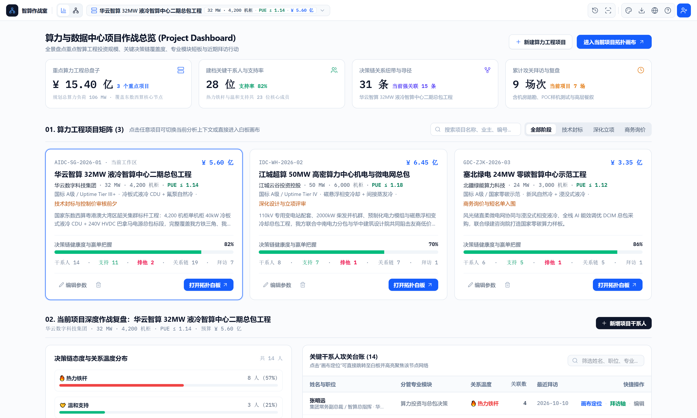
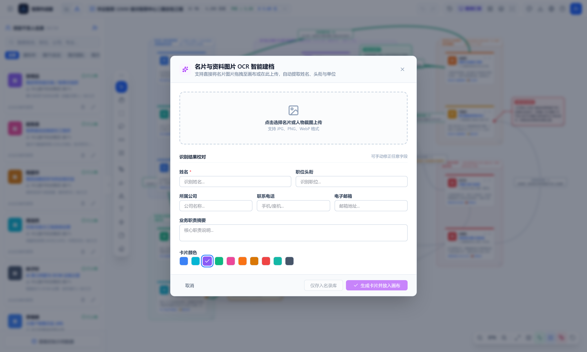
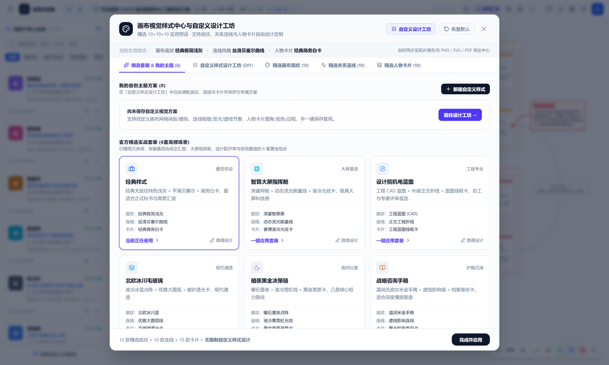
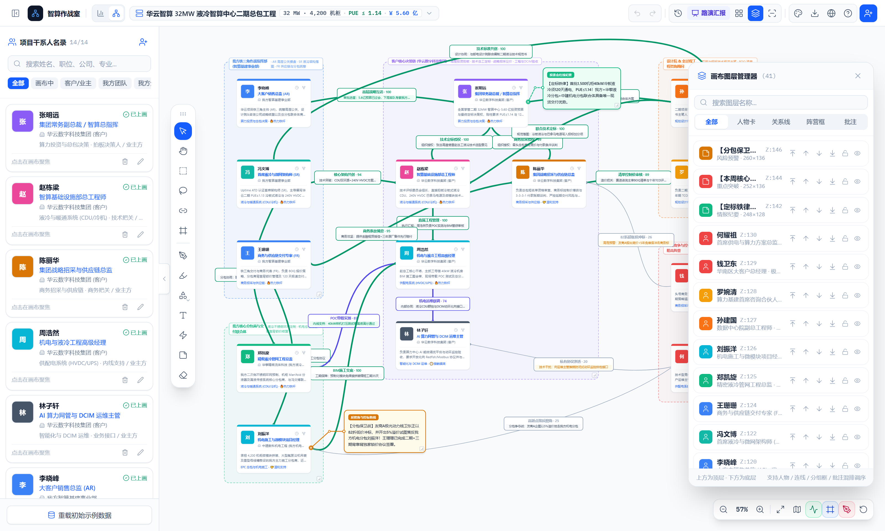
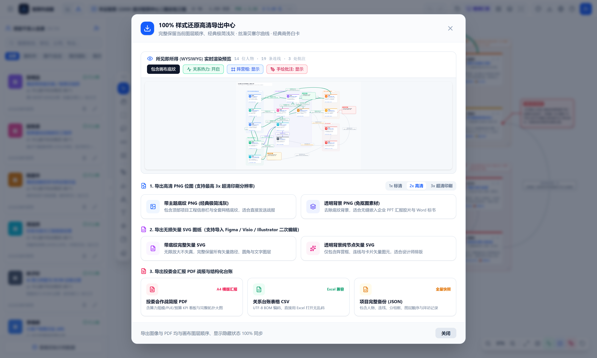

# 数据中心项目客户关系管理系统 (DataCenter CRM)

[](https://github.com/vinhduonglam9-arch/datacenter-crm/releases)
[](https://github.com/vinhduonglam9-arch/datacenter-crm)
[](LICENSE)

面向数据中心（AIDC/IDC）智算基建、机电总包、暖通液冷与供配电业务的大型复杂项目客户关系管理（CRM）平台。在 v3.0 版本中深度升级：引入 **历史快照演进对比 (Snapshot Diff)**、**路演汇报聚焦巡航**、**多维图层分级管理器** 以及 **100% 本地 CPU 离线运行的多模态名片 OCR** 与 **Qwen2.5 结构化语义抽取大模型**。提供铁三角决策链分析、态度跃迁预警、拜访跟进时间线及专业图纸导出。

---

## 📸 系统界面全景预览 (v3.0 官方抓拍)

### 1. 智算项目客户关系拓扑画布 (核心主视图)
支持拖拽、连线、关系温度标记、分组框以及铁三角拍板人/把关人动态定位。


### 2. 算力中心工程作战大屏 (Project Dashboard)
宏观掌控在建算力 MW 总负荷、各标段关键决策链覆盖度、支持率雷达及拜访跟进。


### 3. 历史快照与演进对比 (Snapshot Diff 态度跃迁分析)
一键对比不同攻坚阶段（如可研立项、设计院落图、技术封标前夕）的干系人态度跃迁与突破连线增量。


### 4. 100% 本地 CPU 离线名片 OCR 与结构化提取
无需外网及 GPU，支持模糊拍照名片本地自动纠错与结构化解析，一键入库。


### 5. 画布视觉样式中心 (自定义设计工坊)
内置行业主流深浅工程主题、精选底纹、多种节点与连接线材质，适配多样化汇报场景。


### 6. 画布图层分级管理器
支持对干系人、组织阵营框、关系连接线及手绘批注进行独立锁定、隐藏与上下层级拖拽调序。


### 7. 高清战报与工业级图纸导出中心
提供 1:1 所见即所得的高清 PNG、矢量 SVG、投委会报告 PDF 与 Excel 台账数据导出。


---

## 🌟 核心特性 (v3.0)

### 1. ⏱ 历史快照与演进对比 (Snapshot Diff)
- **阶段作战里程碑冻结**：随时保存当前项目的干系人状态、关系网络与图层配置。
- **态度跃迁与恶化预警**：自动比对两次快照，精准高亮态度正向跃迁（如「接触摸底 → 鼎力支持」）或恶化预警（「支持 → 友商倾斜」）。
- **画布实时对比图层 (Diff Overlay)**：在画布上直观显示新增干系人与新连线标注。

### 2. 100% 本地 CPU 离线名片 OCR 与大模型抽取
- **零显卡要求，普通工控机/笔记本 CPU 顺畅运行**：采用轻量级 `RapidOCR`（ONNXRuntime CPU 算子）配合量化模型 `Qwen2.5-1.5B-Instruct-GGUF`。
- **两阶段流水线架构**：
  - **阶段 1 (字形识别)**：200~400ms 内快速完成名片文字检测、分类定位与识别，解决模糊与低像素问题。
  - **阶段 2 (智能结构化)**：自动纠正识别错误，提取姓名、头衔、公司机构、手机号码、邮箱、核心关注点与标签。
- **多编码自适应解码**：内置 UTF-8 与 Windows 原生 GBK/CP936 智能容错探测，彻底解决中文乱码。

### 3. 算力中心项目全生命周期与铁三角决策链拓扑
- **项目参数画像**：支持算力规模（MW / 机柜数）、设计 PUE 指标、等级标准（国标 A 级 / Tier III+）、制冷架构（冷板式液冷 / 氟泵自然冷）、标段预算及中标把握度。
- **可视化拓扑画布**：
  - 支持拖拽、连线、锚点连接、分组框（GroupFrame）、层级对齐（Faction / Hierarchy Layout）。
  - 人物关系温度与阶段跟踪：标段拍板人、技术把关人、商务负责人、品牌倾向与反感度。
  - 决策链与最短高层穿透路径计算（BFS 算法）。

### 4. 画布图层管理器与自定义样式工坊
- **图层管理器**：41+ 元素独立 Z-index 调序、显隐切换与锁定控制。
- **视觉主题定制**：支持深邃智算黑、设计院机电蓝图、北欧冰川毛玻璃、暗夜黑金决策链等主题与自建方案。

### 5. 样式中心与专业汇报导出
- 支持高质量导出为 **PNG 高清拓扑大图、SVG 矢量图、PDF 工程文档及关系 CSV 数据**。

---

## 📦 桌面端下载与分发方式 (v3.0)

本系统已提供两种面向 Windows 用户的交付形态（均包含完整的离线推理模型与运行环境，**无需目标电脑安装 Node.js、Python、CUDA 或任何依赖**）：

### 1. 完整版 (Standard Edition - 含本地离线 OCR 与 Qwen2.5 大模型)
- **Windows 安装包**：`DataCenter-CRM-3.0.0-Setup.exe` (1.46 GB)
- **绿色免安装便携版**：`DataCenter-CRM-Portable-v3.0.zip` (1.61 GB)
- **特点**：全功能开箱即用，自带 RapidOCR 与 Qwen2.5-1.5B GGUF 离线权重。

### 2. 精简版 (Lite Edition - 去除 OCR 与 AI 模型，超小体积)
- **Windows 安装包**：`DataCenter-CRM-Lite-3.0.0-Setup.exe` (169.05 MB，体积缩小 90%)
- **绿色免安装便携版**：`DataCenter-CRM-Lite-Portable-v3.0.zip` (241.49 MB，体积缩小 85%)
- **特点**：完全移除 OCR 引擎和庞大权重包，极速下载；解压后直接双击根目录 `数据中心CRM精简版.exe` 即可启动原生桌面客户端（无需任何 .bat 脚本）。保留所有算力看板、拓扑画布、历史快照对比、突破寻径、样式中心与高清导出功能。

---

## 🛠️ 本地开发与二次构建

### 运行环境要求
- Node.js >= 18
- pnpm >= 9
- Python 3.10+ (仅在本地开发二次训练/扩展 OCR 脚本时需要；打包后脱离 Python)

### 1. 安装项目依赖
```bash
pnpm install
```

### 2. 开发模式运行
```bash
pnpm run dev
```
启动后访问 `http://localhost:3000`。

### 3. 生产静态资源与后端编译
```bash
# 构建前端 dist 静态文件
pnpm run build

# 编译后端单文件 ESM 路由
pnpm run bundle:server
```

### 4. 构建 Electron 桌面客户端与安装包
```bash
# 生成 Windows NSIS 安装包 (输出至 installer-dist/)
pnpm run pack:installer

# 生成免安装解包目录 (输出至 installer-dist/win-unpacked/)
pnpm run pack:dir
```

---

## 📁 目录架构说明

```
├── Ver3/                  # v3.0 完整版源码工程 (含离线 OCR 与 LLM)
├── Ver3/datacenter-crm-lite/ # v3.0 精简版源码工程 (剔除模型依赖，秒级构建)
├── build/                 # NSIS 定制安装脚本 (installer.nsh) 与 Windows 图标
├── desktop/               # Electron 桌面主进程入口 (main.cjs)
├── dist/                  # 前端 Vite + React 生产静态构建产物
├── docs/screenshots/      # README 预览全景截图
├── models/                # 本地离线 AI 模型权重文件 (分发包自带)
├── bin/                   # 独立免安装底层执行体 (分发包自带)
├── scripts/               # 截图与自动化维护脚本
├── server.ts              # 核心服务端 (OCR 两阶段流水线调度 + 静态托管)
└── package.json           # 项目元配置与 electron-builder 构建规则
```

---

## 🔒 隐私与离线声明
- 本系统在默认配置下名片识别与文本解析 **100% 在本地 CPU 进行计算**，不会向任何公网服务器上传名片图像或客户隐私数据。
- 可选配置：若需使用云端大模型，可在环境配置中填入 `GEMINI_API_KEY`，服务端会自动将其作为后备通道。
