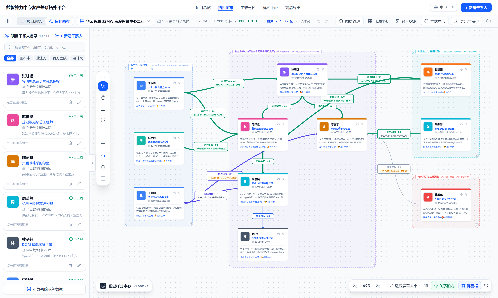
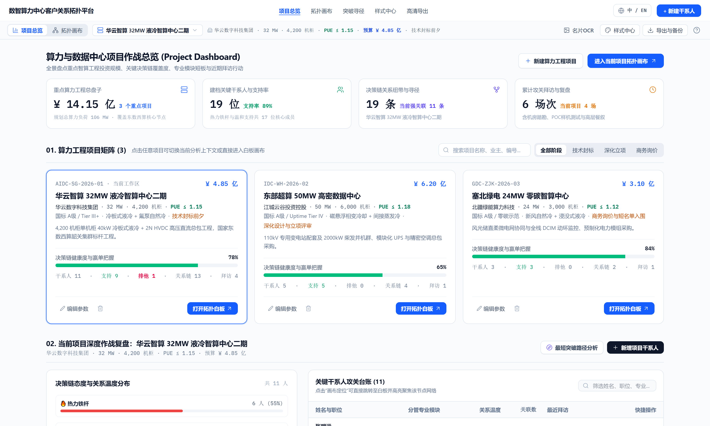
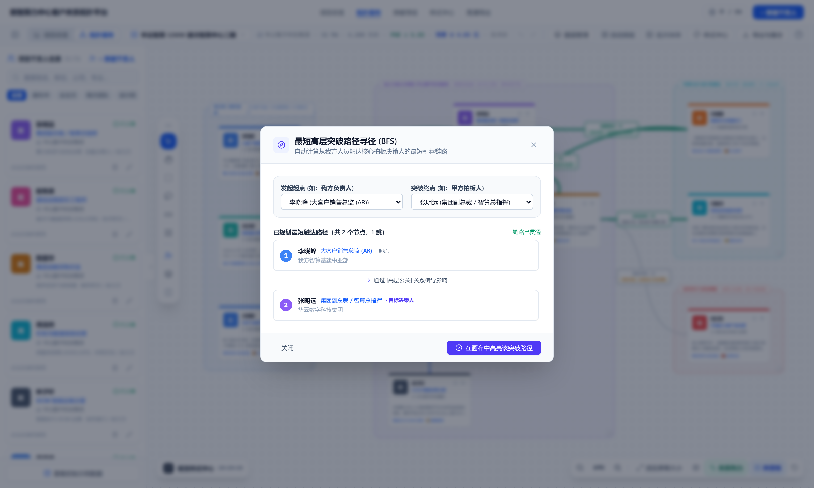
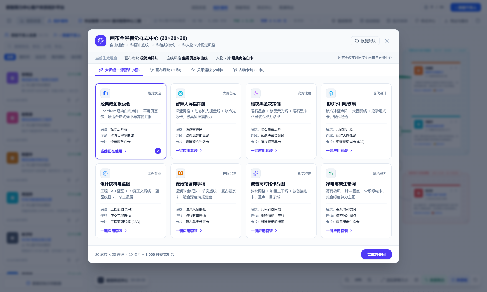
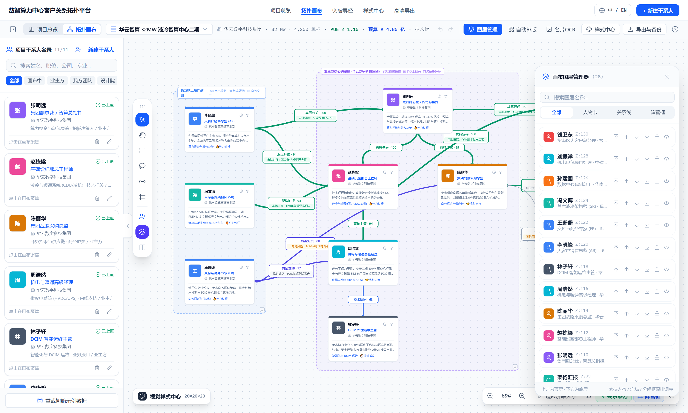

# 数据中心项目客户关系管理系统 - 精简版 (DataCenter CRM Lite)

[](https://github.com/vinhduonglam9-arch/datacenter-crm/releases)
[](https://github.com/vinhduonglam9-arch/datacenter-crm)
[-orange.svg)](https://github.com/vinhduonglam9-arch/datacenter-crm)

面向数据中心（AIDC/IDC）智算基建、机电总包、暖通液冷与供配电业务的轻量化项目客户关系管理（CRM）平台。

> [!NOTE]
> **本版本为精简版 (Lite Edition)**：
> 彻底去除了 OCR 算子依赖与本地 Qwen2.5 GGUF 大模型权重，**体积相比完整版的 1.5GB 锐减 85%（仅 160MB 安装包 / 224MB 绿色便携版）**，专注于**智算项目全生命周期台账、铁三角决策链拓扑、最短突破寻径、20×20×20 样式中心以及高清战报导出**。

---

## 📸 核心界面与功能概览

### 1. 智算项目客户关系拓扑画布 (核心主视图)
支持拖拽连线、关系温度标记、分组框以及铁三角拍板人/把关人动态定位。


### 2. 算力中心工程作战大屏 (Project Dashboard)
宏观掌控在建算力 MW 总负荷、各标段关键决策链覆盖度、支持率雷达及拜访跟进。


### 3. 最短高层突破路径寻径 (BFS 决策链穿透)
自动计算从我方负责人触达甲方核心决策拍板人的最短信任推荐链路。


### 4. 画布视觉样式中心 (20×20×20 定制系统)
内置行业主流深浅工程主题、多种节点与连接线材质，适配多样化汇报场景。


### 5. 图层分级管理器
支持对干系人、组织分组框、关系网进行独立锁定、隐藏与上下层级拖拽调序。


### 6. 高清战报与工业级图纸导出中心
提供 1:1 所见即所得的高清 PNG、矢量 SVG、投委会报告 PDF 与 Excel 台账数据导出。


---

## 📦 桌面端下载与分发方式

本精简版提供两种面向 Windows 用户的即开即用形态（**无需目标电脑安装 Node.js、Python 或任何第三方运行库**）：

### 1. Windows 安装向导版 (NSIS)
- **下载文件**：`DataCenter-CRM-Lite-2.0.0-Setup.exe`（约 154 MB）
- **特点**：标准 Windows 安装向导，自动创建开始菜单和桌面快捷方式，支持安全卸载。

### 2. 纯绿色免安装便携版
- **下载文件**：`DataCenter-CRM-Lite-Portable-v2.0.zip`（约 224 MB）
- **使用方法**：解压至任意目录，双击根目录 `启动系统.bat` 或 `数据中心CRM精简版.exe` 即可直接打开桌面窗口。

---

## ⚖️ 完整版 vs 精简版对比

| 功能特性 | 完整版 (Standard v2.0) | 精简版 (Lite v2.0) |
| :--- | :---: | :---: |
| **安装包体积** | 约 1.45 GB | **约 154 MB (缩小 ~90%)** |
| **绿色版体积** | 约 1.57 GB | **约 224 MB (缩小 ~85%)** |
| **算力项目工程大屏看板** | ✅ | ✅ |
| **铁三角决策链拓扑画布** | ✅ | ✅ |
| **BFS 最短突破路径寻径** | ✅ | ✅ |
| **图层管理器与阵营分栏** | ✅ | ✅ |
| **20×20×20 视觉样式中心** | ✅ | ✅ |
| **PNG/SVG/PDF/CSV 高清导出** | ✅ | ✅ |
| **RapidOCR 离线名片拍照识别** | ✅ | ❌ (移除) |
| **Qwen2.5-1.5B 本地大模型抽取** | ✅ | ❌ (移除) |

---

## 🛠️ 本地开发与编译

```bash
# 安装依赖
pnpm install

# 开发运行
pnpm run dev

# 构建精简版安装包
pnpm run pack:installer
```
